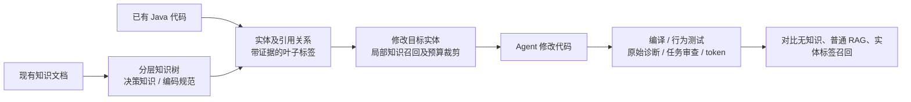

# 项目进度与新对话交接

更新时间：2026-11-02。适用仓库：`ontology-demo`，工作分支：`work`。本快照的实现基线为 `cbef623`；文档提交以 `git log -1` 为准。

**当前定位：原型链路已打通，首次真实试点已完成；正在补齐独立评价依据，尚未证明整体收益。**

配套的 [进度与后续计划表](PROJECT-BOARD.md) 是执行看板；本文件说明目标、证据和恢复步骤。状态必须以文件和实际执行记录为准，不能只凭对话回忆。

## 我们到底在做什么

用户原始创新提案是：把现有知识库组织成思维导图式层级，将代码实体关联到最小知识分支，在 Agent 修改已有代码时召回少量相关知识，观察代码是否更符合规范。



当前限定 Java / 线程池领域。规则检查器和 Java 测试是评价组件，不能把最终目标改写成单纯的风险诊断工具。暂不建设大型图平台，也尚未接入 Cline。

## 已完成到哪里

| 原目标环节 | 已实现 | 尚未证明或覆盖 |
| --- | --- | --- |
| 分层知识 | 1 个根、2 个主干、15 个叶子；关联 26 条规则；区分决策与规范；补充适用、排除和所需事实草案 | 叶子粒度与语义尚待领域确认；不能靠“队列必须有界”代替参数决策 |
| 实体关联与召回 | 文件内轻量 CodeGraph，包含类、接口、方法、构造器、字段及引用；标签有来源证据、版本指纹与失效检查；修改目标按有限依赖展开和预算召回 | 不支持完整跨文件调用图；独立标签准确率未知；新能力 planned 仍需显式输入 |
| Agent 效果实验 | 完成 3 任务 × 3 策略真实 DeepSeek 试点，共 9 次调用；源码、响应、用量、哈希与补充诊断已归档 | 样本少且为开发自编；缺少独立真实修改任务和独立评审；没有稳定收益结论 |
| 下一轮评价基础 | 3 个现有标签候选任务、45 项空白标注、无预测评审包、密封评分流程及 Java 验收草案 | 当前没有真实领域标注；新候选尚未接通正式付费执行，不可直接使用旧固定验收器 |

实现说明见 [完整链路](TAGGED-KNOWLEDGE.md)。规则组件的范围见 [能力清单](CAPABILITIES.md)、[缺陷覆盖复盘](RULE-COVERAGE-REVIEW.md)。

## 已有实验告诉我们什么

以下仅指实体标签路线首次真实试点，不混入此前平铺规则实验。

| 策略 | 编译通过 | 原配置行为验收通过 | 静态遵循均值 | 实际 total tokens |
| --- | --- | --- | --- | --- |
| 无知识 Baseline | 3/3 | 3/3 | 80.7% | 1,864 |
| 普通 BM25 RAG | 3/3 | 3/3 | 80.7% | 3,996 |
| 实体标签 tagged | 3/3 | 3/3 | 78.5% | 3,819 |

补充 Agent 源码审查和 JVM 诊断发现 Baseline / RAG 漏记回调异常，任务范围审查为 2/3、2/3、3/3。但该差异出现在手工 planned 提供知识的任务，不能归因于已有实体标签。原静态结果还包含中断恢复误报、拒绝传播政策待判定和预存问题；原始分数均保留。不能将有限行为测试通过写成全面正确。

详见 [首次真实试点及证据](../eval/tagged-edit/experiments/2026-11-02-firstpass/README.md)。模型为当时记录的 `deepseek-flash`，不是此前尝试的 Ruoli 模型。总计 9,679 tokens，不推算未经核实的货币成本。

## 当前正在做什么

最新实现 `cbef623` 交付了三个 **Agent 自编开发候选**：容量与内存约束决策、租户上下文恢复、后台失败记录。主队列均为 `planned=[]`，用于观察已有实体标签能否覆盖需求。参考修改支持多种合理容量配置，验收覆盖实际回调与失败原因。

- [候选任务与实体对应表](ENTITY-REVIEW-MATRIX.md)：面向项目负责人。
- [评审操作说明](../eval/entity-review/README.md)：准备、填写、密封、评分与口径。
- [独立评审分发包](../eval/entity-review/prepared/2026-11-02/reviewer-package.zip)：只把此包交给尚未看过预测的评审者。
- [验证摘要](../eval/entity-review/validation/summary.json)：类型检查通过，完整回归 183/183，0 失败、0 跳过；该轮新增模型调用 0。

**当前真实标注为 0/45，metrics=null。** 评审身份独立性只能自声明，未做认证；即使候选标注完成，也不会自动成为独立真实保留集。引擎预测、Agent 参考实现和测试模拟身份不得代替独立答案。

## 下一步按什么顺序推进

具体任务、依赖和验收标准在 [执行看板](PROJECT-BOARD.md)。下一项是 P1：确定真实 Java 项目、修改需求及领域评审者。目前用户尚未提供项目来源和评审人，不能自行虚构。若仍未提供，可先整理公开项目候选与适配范围，明确标为候选，不能直接宣布已建立独立基准。

随后审阅知识叶子、填写独立标签，分别检查候选集合漏召回与预算裁剪损失，针对确认问题修复并另存验证。正式模型实验前必须适配新任务验收、冻结输入和完整三组矩阵；不得直接把新 suite 塞进旧 tagged-edit 的固定验收器。独立性不足时只报告开发集结果。

已有用户授权使用充值后的 DeepSeek API，但当前安排先完成有效的评价基础，不因为“继续”就重复付费试跑。后续达到条件时按已有授权执行完整冻结矩阵，记录每次调用；不选择性补跑、不覆盖历史。

只有证据支持可靠召回、任务收益与可接受维护成本，才进入 Cline 的 retrieve / validate 展示试点。收益不足则明确报告并缩小范围，不能预设实验一定成功。

## 新对话如何无缝继续

将以下文字发给新对话，并确保它连接到同一仓库或远程 `work` 分支：

> 请继续 ontology-demo 的原始创新提案。先读取 docs/PROJECT-PROGRESS.md 和 docs/PROJECT-BOARD.md，再核对 work 分支、git 状态和最新证据，从看板第一项未完成任务继续。目标是分层知识树 → 代码实体标签 → 修改时局部召回 → 对比 Agent 质量，不能改成单纯诊断工具。保留历史实验，不虚构独立标注；如果缺少真实项目或评审人，先做不依赖这些输入的准备，并说明缺口。完成后同步更新交接文档和看板。

新执行者顺序：

1. 先找本地 AGENTS.md 并遵循；读取本文件、看板、entity-review/README 和首次真实试点 README，避免从旧方案重新开工。
2. `git status --short --branch`、`git log -5 --oneline`；保护未提交工作，确认当前基线。新环境没有仓库时检出远程 `work`，不要只依赖聊天记忆。
3. 核对 Node、JDK、依赖及网络凭据配置；本地缓存不随 Git 迁移。读取云环境技能、检查当前环境，不能沿用上个会话的凭据就绪判断。
4. 根据看板依赖推进。源码、任务、叶子或预算变化要建新评审包，重新确认标签；不要覆盖冻结包或实验。
5. 报告实测结果、未完成事项及下一步，同步两份文档。提交后在交接记录写实际提交号或以 git log 查询，避免循环修改文档仅为填写自身哈希。

仓库根目录常用恢复命令：

```bash
node --version                    # 要求 >=22.18；最近使用 Node 24
npm ci                            # 仅在依赖缺失/需恢复时
npm run setup:java                # 仅在 JDK 缺失时；最近验证 JDK 21
npm run setup:eval                # 恢复固定 Java 依赖及本地测试输入
npm run check:eval
npm run typecheck
npm run test:eval                 # 源码或验收变化后完整回归；文档变更不必重跑
```

`scripts/eval-env.sh` 负责 Java 选择，优先 JAVA_HOME、其次 `.tools/jdk`、最后系统 javac；完整测试会检查固定依赖。旧实验有源码/工作区来源约束，失败时先读错误及协议，不能为“变绿”悄悄放宽校验。

新建评审包和真实评分的命令（输出路径必须未存在）：

```bash
node eval/entity-review/workflow.ts prepare eval/entity-review/suite.json .eval-cache/review-next
# 只有真实评审填写后才执行以下两步，不能填入引擎预测
node eval/entity-review/workflow.ts seal .eval-cache/review-next/reviewer filled.json .eval-cache/review-next-sealed.json
node eval/entity-review/workflow.ts score .eval-cache/review-next/reviewer .eval-cache/review-next-sealed.json .eval-cache/review-next-metrics.json
```

新候选的正式模型执行尚待适配，故本交接不提供一个貌似可直接运行的付费命令。旧试点的执行与控制条件见 [协议](../eval/tagged-edit/PROTOCOL.md)。

环境使用 `EVAL_API_BASE`、`EVAL_API_KEY`；当前云环境密钥绑定名为 `DEEPSEEK_API_KEY`，仅限 api.deepseek.com。只核对就绪状态，不读取或复制值，不把聊天中出现的密钥写入文档。新环境需重新配置；网络拒绝时走环境配置流程，不绕过代理。

## 本次交接记录与维护约定

2026-11-02：在 `cbef623` 基线上新增本交接与看板，未修改引擎、规则、候选或历史实验，未新增模型调用。183 项通过引用上一轮归档验证，并非本次文档更新重新运行所得。

每轮完成后同时更新：日期、实现基线、看板状态、证据链接、验证结果、阻塞输入、第一项可执行任务。历史结果保留原样；新增结论和验证另存。缺少评审或真实来源时状态保持“等待输入”，不能因生成了文件就改成“效果已验证”。
