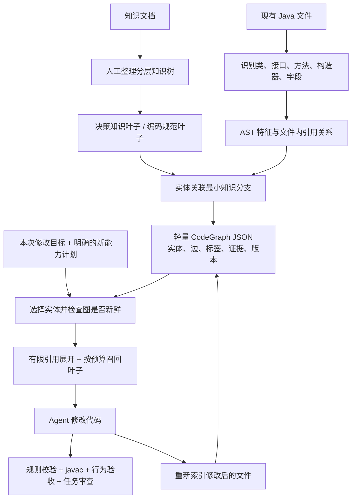

# 分层知识 → 代码实体标签 → 修改时局部召回

本轮沿原目标补齐知识组织、实体关联和修改实验准备。目标仍是验证 Agent 是否更符合规范；校验器与 Java 测试是测量和反馈组件，不取代该目标。本轮无新增模型请求。



## 1. 知识树与最小分支粒度

来源为现有两份线程池文档，配置在 `knowledge-tree/thread-pool.json`。树结构独立于原 YAML 规则库，避免把知识目录节点误当成原子规则。当前 1 个根、2 个主干、15 个叶子，关联现有全部 26 条规则。

```text
线程池 tp
├── 创建与参数决策 tp.create
│   ├── 任务类型与线程模型       tp.create.workload    [决策]
│   ├── 线程数与空闲回收         tp.create.sizing      [决策]
│   ├── 任务队列选择             tp.create.queue       [决策]
│   ├── 过载与拒绝策略           tp.create.rejection   [决策]
│   ├── 显式配置与生命周期归属   tp.create.explicit    [规范]
│   └── 线程工厂与业务命名       tp.create.naming      [规范]
└── 使用代码方式 tp.use
    ├── 提交方式与结果消费       tp.use.result         [规范]
    ├── 等待超时与实际任务取消   tp.use.timeout        [规范]
    ├── 异步编排与执行器隔离     tp.use.async          [规范]
    ├── 调用方及工作线程上下文   tp.use.context        [规范]
    ├── 任务异常与周期执行       tp.use.exception      [规范]
    ├── 优先级与淘汰顺序         tp.use.priority       [规范]
    ├── 关闭与等待终止           tp.use.shutdown       [规范]
    ├── 强制关闭未执行任务处置   tp.use.pending        [规范]
    └── 可观测性                 tp.use.monitor        [规范]
```

一个叶子是一次召回的最小完整知识单元，应能回答一个局部工程问题；可以关联数条原子规则，不要求与 checker 一一对应。比如队列选择必须同时说明选择条件与约束，不能把“必须有界”当作完整选型答案。叶子过长或涵盖独立问题时应继续拆分；当前是首版人工建模，不声称最优粒度。

| 类型 | 内容 | 是否自动作结论 |
| --- | --- | --- |
| 决策知识 | 输入条件、可选方案、取舍、未知条件；如有限缓冲、直接交接、优先级需求与下游并发 | 不自动选出唯一最佳参数；条件不足须询问或测量 |
| 编码规范 | 已选方案下的义务、示例语义和关联规则；如取消实际句柄、恢复上下文 | 仅已有 checker 的有限覆盖可自动检查；其余仍需测试与审查 |

例如 `tp.create.queue` 包含：有限缓冲时评估 ArrayBlockingQueue / 显式容量 LinkedBlockingQueue；不排队时评估 SynchronousQueue 与线程上限、拒绝联动；优先级任务评估排序与饥饿，以及 PriorityBlockingQueue 初始容量不构成上限。决策还需排队延迟、任务内存与突发量信息，不凭标签编造负载参数。

每个叶子保存稳定 ID、父节点、kind、特征条件、可选属性条件、正文、原规范来源和关联规则 ID。优先级规范额外要求队列类型证据，普通 FIFO 队列不会仅因具有 QUEUE 特征就被打上优先级标签。知识树加载校验唯一 ID、父链、叶子完整性、特征和规则引用、来源文件；树指纹包含原文档与规则内容。

## 2. 代码实体、标签与追溯

轻量图存为 JSON，不引入图数据库。现阶段按文件建图；不声称跨文件继承、接口实现或全项目调用图已完成。

| 实体 | 打标方式与用途 |
| --- | --- |
| 类 | 聚合成员标签，适合修改范围确实是整个类时选择；不向每个方法反向灌入全部类标签 |
| 接口及抽象方法 | 保留实体；没有实现证据就不猜测并发语义，可提供带理由的人工绑定 |
| 方法 / 构造器 | 局部 AST 特征及计划修改的主要选择点；重载按参数类型区分 |
| 字段 | 承载线程池、队列、上下文等资源配置；方法沿引用边获得相关知识 |

实体 ID 示例：`文件路径#包名.类名::方法名(参数类型)`，字段使用 `::field:名称`。相同行列变化不改变签名 ID；重命名或改签名产生新 ID。类型名称是文件内词法签名，尚不是 Java 全项目符号解析。

图边包括 `contains`、`uses`、`calls`：归属、字段使用、当前类内可明确解析的调用。方法召回最多沿两跳 uses / calls 展开，不沿 contains 扩散到全部兄弟方法，不反向遍历调用者。复杂调用链需要显式选择额外实体；宁可记录覆盖边界，不默认加载整类知识。

每个标签包含叶子 ID、origin（AST / 人工 / 聚合）、特征 ID、行列、源码片段、置信度及属性，聚合标签还保留来源实体。人工标签必须有明确实体和理由。计划新增知识独立记录 reason，不写成“现有代码已具有该能力”的 AST 标签。返回结果保留标签与依赖路径，便于追溯为何召回某个叶子。

## 3. 代码变化后的更新规则

1. 持久化源文件哈希、知识树哈希和 tagger 版本。召回前校验；代码、文档 / 规则、tagger 版本变化时拒绝旧图。
2. 改写成功后重新索引整个受影响文件，重建 AST 标签和文件内边，删除已消失的事实，不在旧图上堆叠历史标签。
3. 方法签名未变时保持实体 ID，但重新计算位置和证据；签名删除后不能继续按旧 ID 召回。
4. 索引失败或 Java 有语法错误时不覆盖上一份图；旧图仍因哈希不匹配而不可召回。
5. CLI 遇到人工标签且代码或知识变化，要求用 `--manual` 显式重新确认绑定；不静默沿用可能过期的人工判断。人工标签的实体消失或叶子无效时拒绝索引。

初期没有文件监听器和跨文件增量传播；由宿主或使用者在读写文件边界调用 index。知识变化可暂时重建全部图，待性能证据支持后再优化。

## 4. 新增能力如何召回

现有标签只描述现状。例如 EventPublisher 原先同步调用 Consumer，不会自动获得线程池标签。当任务要求异步发布时，调用方显式提供新增队列、拒绝、异常与关闭知识的计划及理由。

本版不通过任务关键词自动猜标签。计划作为可追溯输入优先进入预算选择；同样的计划事实写入三组公共任务，避免只有标签组知道业务需求。后续可让 Agent 提议计划，但仍应显式记录，并另外测量提议准确性。

## 5. 可运行命令

```bash
# 查看完整树
node src/codegraph/cli.ts tree

# 为一个现有文件建立轻量图
node src/codegraph/cli.ts index \
  --file eval/tagged-edit/cases/BufferedNotifier.java \
  --graph .eval-cache/notifier-graph.json

# 查看实体 ID、边、标签与证据
node src/codegraph/cli.ts inspect --graph .eval-cache/notifier-graph.json

# 仅围绕指定修改方法召回
node src/codegraph/cli.ts retrieve \
  --graph .eval-cache/notifier-graph.json \
  --entity 'eval/tagged-edit/cases/BufferedNotifier.java#BufferedNotifier::send(String)' \
  --budget 1200

# 准备三组代码修改提示词，不调用模型，输出目录必须是新目录
node eval/tagged-edit/prepare.ts eval/tagged-edit/suite.json .eval-cache/edit-run-new
```

召回预算计算包含标题、来源和正文的完整序列化知识文本；返回 selected / dropped 叶子及 warning，不把预算截断结果说成完整覆盖。CLI 人工绑定 JSON 元素格式为 `{ "entity": "精确实体ID", "leaf": "知识叶子ID", "reason": "人工判断依据" }`；`--planned` 文件元素使用 `{ "leaf": "知识叶子ID", "reason": "本次新增能力依据" }`。

## 6. 本轮交付边界

已实现：知识树及校验、文件内实体建模与证据标签、JSON 存取和失效检查、按修改实体与计划召回、三组实验准备、显式预算的供应商执行记录器、导入 / 记录结果的编译 / 行为 / 规范评估，以及 JSON / Markdown 报告。新的执行器已用参考代码适配器跑通 9 个槽位，未调用真实供应商。

尚未验证：标签组是否提升真实 Agent 修改质量、跨文件代码图、无人工计划时的新能力召回准确率、生产标签更新成本。尚未自动执行付费三组实验，也未接入 Cline。旧实验的 flat Rules 策略不能冒充这条完整路线的效果证据。

修改实验协议、已编译输入、Java 行为验收和参考实现说明见 [实验协议](../eval/tagged-edit/PROTOCOL.md)。

本轮本地验证：类型检查通过，JDK 21 与固定依赖校验通过，定向 9/9、完整回归 167/167，均无失败、无跳过；日志见 `eval/tagged-edit/validation/`。这些是实现与验收器的本地验证，不是三组模型效果成绩。

执行器补充验证：完整回归 174/174，0 失败、0 跳过，类型检查通过；参考适配器 9/9 输出均通过编译及配置行为验收，真实供应商请求 0。新日志见 `eval/tagged-edit/execution-validation/`；不构成标签路线的模型效果结论。
